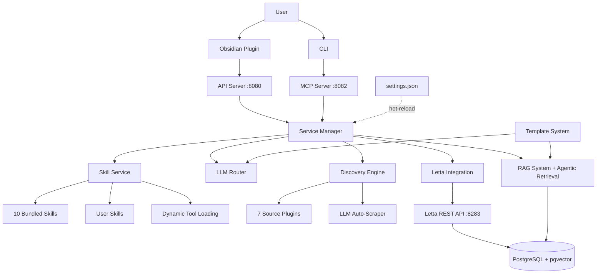

<p align="center">
  
</p>

# Asistente de Investigación Thoth

Un asistente de investigación extensible y local-first para mantenerte al día con los artículos de IA/ML. Construido con Python, Letta y Obsidian.

[](https://python.org)
[](LICENSE)

---

## Acerca de Este Proyecto

### El Problema

Como profesional de la IA que equilibra un empleo a tiempo completo mientras intento mantenerme actualizado con los rápidos avances en investigación de IA, me encontré ahogado en artículos. Las herramientas de investigación existentes eran demasiado rígidas: me encasillaban en su flujo de trabajo, sus fuentes y sus esquemas de extracción. No podía agregar fácilmente nuevas fuentes de artículos, personalizar qué metadatos se extraían o controlar dónde se almacenaban mis datos.

Pero la verdadera fricción no era solo la falta de personalización, sino la **interfaz**. Las herramientas de investigación me obligaban a buscar constantemente en archivos de configuración, crear innumerables configuraciones de memoria, editar archivos YAML y gestionar docenas de archivos de reglas. Sí, *podía* editarlos manualmente, pero ¿por qué debería esa ser la única opción?

### La Visión

Los usuarios quieren un único punto de integración: lenguaje natural. No quieren gestionar archivos, quieren decirle al agente lo que necesitan y que este lo haga.

Esto impulsó una decisión arquitectónica central: **el agente tiene acceso a todo lo que un usuario puede hacer manualmente**. Cada configuración, cada plantilla de prompt, cada consulta de investigación, cada esquema de extracción: el agente puede leer y modificar todo ello a través de herramientas MCP. El sistema es profundamente configurable, pero los usuarios no deben tener que aprender la superficie de configuración para usarlo.

En la práctica, esto significa que puedes decir cosas como:
- *"Las notas que estás generando a partir de los artículos deben incluir secciones de metodología"* — el agente actualiza el esquema de análisis
- *"Mi pregunta de investigación sobre el aprendizaje por refuerzo sigue trayendo demasiados artículos de robótica"* — el agente edita la consulta de investigación para ajustar el alcance
- *"Cambia a usar Anthropic para el análisis de documentos"* — el agente actualiza la configuración de enrutamiento del LLM

Los usuarios avanzados aún pueden editar `settings.json`, plantillas de prompts y esquemas a mano. Pero la mayoría del tiempo, simplemente hablas con el agente. También hay un asistente de configuración TUI (`thoth setup`) para la configuración inicial, por lo que la experiencia de primer uso tampoco es abrumadora.

### ¿Por qué Letta?

Después de probar varios frameworks de agentes, [Letta](https://www.letta.com/) (anteriormente MemGPT) fue el primero que *realmente* recordaba lo importante. Su arquitectura de memoria de autoedición significaba que el agente retenía contexto sobre mí, mi trabajo y mis preferencias entre sesiones, no mediante ingeniería de prompts frágil, sino a través de bloques de memoria estructurados y persistentes.

La flexibilidad de Letta y la capacidad de personalización de su SDK se alinearon bien con el ethos de este proyecto: control del usuario sobre todo. Fue diseñado para ser extendido, no para encasillarte en el flujo de trabajo de un solo proveedor.

### El Resultado

Thoth es un asistente de investigación construido para personas que quieren tanto potencia como facilidad de uso:
- **Interfaz de lenguaje natural** para uso diario (chatea con el agente)
- **Control manual total** para personalización (edita plantillas, esquemas, configuraciones)
- **Local-first** para privacidad (tus datos se quedan en tu máquina)
- **Extensible** a través de estándares (herramientas MCP, fuentes con plugins, plantillas Jinja2)
- **Memoria persistente** a través de Letta (contexto que realmente sobrevive entre sesiones)

Es la herramienta que necesitaba pero no pude encontrar, así que la construí.

---

## Inicio Rápido

### Requisitos Previos

- **Docker** instalado y en ejecución ([Obtener Docker](https://docs.docker.com/get-docker/))
- **Obsidian** instalado ([Descargar Obsidian](https://obsidian.md/download))

### Instalación en Un Solo Comando

```bash
# Linux/Mac
curl -fsSL https://raw.githubusercontent.com/acertainKnight/project-thoth/main/install.sh | bash

# Windows (via WSL2)
wsl --install  # if needed
curl -fsSL https://raw.githubusercontent.com/acertainKnight/project-thoth/main/install.sh | bash
```

El instalador verifica que Docker esté en ejecución, lanza un asistente de configuración en un contenedor e instala el comando CLI `thoth`. Toma aproximadamente 5 minutos.

### Configuración para Desarrollo

```bash
git clone https://github.com/acertainKnight/project-thoth.git
cd project-thoth

uv sync
export OBSIDIAN_VAULT_PATH="/path/to/your/obsidian/vault"
make dev
```

### Comandos Diarios

```bash
thoth start       # start services (~4GB RAM)
thoth status      # check what's running
thoth stop        # shut it down (free RAM)
thoth logs        # view logs
thoth update      # pull latest version
```

---

## Arquitectura

Thoth está construido alrededor de servicios débilmente acoplados con un backend compartido PostgreSQL+pgvector. Letta se ejecuta de forma independiente de Thoth: reiniciar Thoth nunca afecta la memoria de tu agente ni el historial de conversaciones.



### Decisiones Clave de Diseño

- **Chat como configuración**: Cada configuración, plantilla de prompt y esquema de extracción es editable por el agente a través de herramientas MCP. Los usuarios describen en lenguaje natural lo que quieren cambiar y el agente se encarga. La edición manual siempre está disponible para usuarios avanzados, y un asistente de configuración cubre la configuración inicial.
- **Letta para memoria**: Memoria de autoedición a través de llamadas a herramientas, estado persistente con PostgreSQL+pgvector, basado en el [artículo de MemGPT](https://docs.letta.com/). Los agentes actualizan su propio contexto entre sesiones sin límites de ventana de contexto.
- **MCP para herramientas**: Protocolo estándar de la industria para la integración LLM-herramienta. Las herramientas se adjuntan/desadjuntan dinámicamente según las habilidades activas, y el sistema funciona con cualquier cliente compatible con MCP.
- **Arquitectura de plugins para fuentes**: 7 plugins de fuente integrados (ArXiv, Semantic Scholar, NeurIPS, ICML, OpenReview, ACL, Papers with Code) más un raspador automático impulsado por LLM que puede generar nuevos plugins a partir de cualquier URL.
- **Plantillas Jinja2 para prompts**: Cada prompt enviado a un LLM es una plantilla Jinja2 que puedes leer y editar. Sin ingeniería de prompts oculta.
- **Carga de herramientas basada en habilidades**: Los agentes inician con 4 herramientas principales y se expanden bajo demanda. Cargar una habilidad adjunta sus herramientas a través de la API de Letta. Mantiene el contexto pequeño y el rendimiento del LLM alto.

---

## Características

**Sistema de Agentes** — 2 agentes especializados (orquestador + analista) con 60 herramientas MCP en 16 categorías. 6 bloques de memoria por agente (persona, preferencias, contexto de investigación, habilidades cargadas, planificación, pizarrón). Las conversaciones y el conocimiento persisten entre sesiones a través de Letta.

**Sistema de Habilidades** — 10 habilidades integradas (paper-discovery, deep-research, knowledge-base-qa, online-research, rag-administration, y más). Los usuarios pueden crear habilidades personalizadas en su vault. Las habilidades se recargan en caliente sin reiniciar servicios.

**Descubrimiento de Investigación** — 7 plugins de fuente más un constructor de raspadores automatizado que utiliza Playwright + un LLM para auto-detectar elementos de artículos en cualquier página web. Soporta descubrimiento programado, deduplicación y filtrado por fecha de publicación.

**Procesamiento de Documentos** — Pipeline de 8 etapas: extracción de texto, metadatos, citas, enriquecimiento, fragmentación (chunking), etiquetas, notas de Obsidian y construcción de índice híbrido. La resolución de citas se ejecuta a través de una cadena de 6 etapas (Crossref, OpenAlex, ArXiv, comparador difuso, validador, motor de decisiones).

**Búsqueda RAG e Híbrida** — Búsqueda semántica (pgvector) + BM25 (tsvector) con Fusión de Rango Recíproco (RRF). Reclasificación opcional basada en LLM o Cohere. Fragmentación consciente de documentos preserva la estructura del artículo. El modo de recuperación agentica añade un ciclo de autocorrección con expansión de consultas, clasificación de documentos y verificación de alucinaciones para preguntas complejas de múltiples pasos.

**Configuración** — Un solo archivo `settings.json`, recargable en caliente en modo de desarrollo (~2 segundos). Todo reside en tu vault de Obsidian bajo `_thoth/`. Cambia configuraciones a través del chat o editando archivos directamente.

---

## Variables de Entorno

| Variable | Requerido | Propósito |
|----------|----------|---------|
| `OBSIDIAN_VAULT_PATH` | Sí | Ruta a la raíz de tu vault de Obsidian |
| `API_OPENAI_KEY` | Sí | Embeddings para RAG + memoria de Letta |
| `API_OPENROUTER_KEY` | Sí | LLM de backend para análisis y enrutamiento |
| `API_MISTRAL_KEY` | Sí | Extracción OCR de PDF (mistral-ocr-latest) |
| `API_COHERE_KEY` | No | API de Reclasificación Cohere (opcional, mayor calidad) |
| `API_SEMANTIC_SCHOLAR_KEY` | No | Clave API de Semantic Scholar |

### Configuración de Letta

Thoth utiliza [Letta](https://www.letta.com/) para la memoria de agentes. Puedes usar Letta Cloud (alojado, con nivel gratuito disponible) o autoalojarlo con Docker. Consulta [docs/letta-setup.md](docs/letta-setup.md) o [docs/letta-cloud-setup.md](docs/letta-cloud-setup.md) para más detalles.

---

## Estructura del Proyecto

```
project-thoth/
├── src/thoth/                    # Código fuente Python
│   ├── cli/                      # CLI (14 módulos de comando + asistente de configuración)
│   ├── mcp/                      # Servidor MCP + 60 herramientas
│   ├── services/                 # Capa de lógica de negocio
│   ├── discovery/                # Descubrimiento multi-fuente + raspador de navegador automático
│   ├── server/                   # API REST FastAPI (13 routers)
│   ├── analyze/                  # Resolución de citas + análisis de contenido
│   ├── rag/                      # Búsqueda vectorial, reclasificación, embeddings
│   ├── pipelines/                # Pipelines de procesamiento de documentos
│   ├── repositories/             # Capa de acceso a datos
│   └── .skills/                  # 10 habilidades integradas + paquetes de roles
│
├── obsidian-plugin/              # Plugin de Obsidian en TypeScript
├── templates/                    # Plantillas de prompt Jinja2 + esquemas de análisis
├── docker/                       # Dockerfiles específicos por servicio
├── tests/                        # Suite de pruebas
└── docs/                         # Documentación
```

## Desarrollo

```bash
pytest tests/                     # run all tests
pytest --cov=src/thoth tests/     # with coverage
uv run ruff check                 # lint
uv run ruff format                # auto-format
```

## Documentación

- [Guía de Configuración](docs/setup.md) — instalación y configuración
- [Arquitectura](docs/architecture.md) — análisis en profundidad del diseño del sistema
- [Filosofía de Diseño](docs/design-philosophy.md) — principios y compensaciones
- [Guía de Uso](docs/usage.md) — uso diario
- [Referencia Rápida](docs/quick-reference.md) — hoja de trucos de comandos
- [Arquitectura MCP](docs/mcp-architecture.md) — sistema de herramientas
- [Sistema de Descubrimiento](docs/discovery-system.md) — descubrimiento de artículos
- [Pipeline de Documentos](docs/document-pipeline.md) — procesamiento de PDF
- [Sistema RAG](docs/rag-system.md) — búsqueda y recuperación
- [Integración Letta](docs/letta-architecture.md) — memoria de agentes
- [Sistema de Habilidades](docs/skills-system.md) — carga dinámica de habilidades
- [Despliegue con Docker](docs/docker-deployment.md) — configuración de contenedores

## Contribuir

Las contribuciones son bienvenidas. Consulta [CONTRIBUTING.md](CONTRIBUTING.md) para las directrices.

## Licencia

Licencia Apache 2.0 — consulta [LICENSE](LICENSE).

---

*Construido con Python 3.12, TypeScript, FastAPI, Letta, PostgreSQL+pgvector y Obsidian.*
